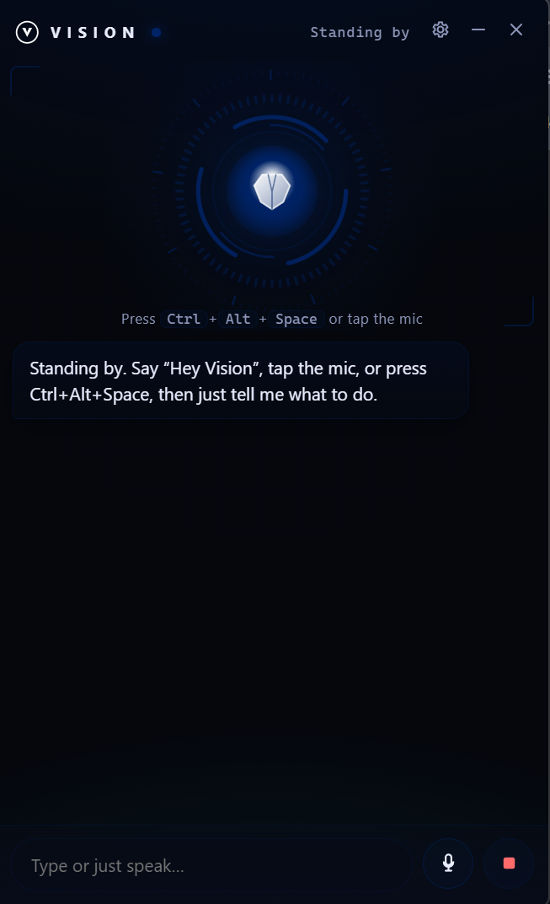

<div align="center">

# Vision

**A voice-controlled AI assistant that sees and operates your Windows PC.**

Say *"Hey Vision"*, tell it what to do, and it does it: opens apps, manages files, searches the web, reads your screen, clicks and types for you, and runs long jobs in the background.

Built on the Google Gemini Live API · Windows 10 / 11 · Made by Mostafa Mamdouh

</div>

<div align="center">



</div>

> **Please read the [disclaimer](DISCLAIMER.txt) before you use Vision.** It can control your computer. You are responsible for what you ask it to do.

## What it can do

| Area | Examples |
|---|---|
| **Talk naturally** | Real-time voice conversation (Gemini Live), spoken answers, interrupt it any time |
| **Wake word** | Say "Hey Vision" / "Okay Vision". Detection runs **offline on your PC** using Windows' own speech recognizer |
| **Control your PC** | Open apps and files, focus / snap / close windows, volume and brightness, media keys, lock / sleep / restart |
| **See and act on screen** | "Click the Save button", find things on screen, highlight them with a ring, scroll, drag, type into fields (Windows UI Automation + a vision model) |
| **Multi-step jobs** | Hands a goal to a visual agent that looks, clicks and types until the job is done |
| **Files** | Search by name or content, read PDF / Word / Excel / PowerPoint, organize folders, find duplicates, convert files, archive |
| **Background automations** | "When this download finishes, open the installer…" Saved to disk, survives closing the window and restarts |
| **Web and info** | Web lookup, weather, currency and unit conversion, calculator, YouTube playback, Chrome / Edge bookmarks |
| **Everyday helpers** | Reminders, to-do list, notes, calendar events, email drafts, clipboard, screen captures |
| **Transcription** | Transcribe your microphone, the audio playing on your PC, or an audio / video file to a text file |
| **PC doctor** | Diagnose and fix common Windows problems (asks first, and asks for administrator rights only when a fix needs them) |
| **Memory** | Remembers facts and personal shortcuts ("work" = this folder) across conversations |

### Shortcuts

| Keys | Action |
|---|---|
| `Ctrl+Alt+Space` | Start / stop listening (voice only, the window stays hidden) |
| `Ctrl+Alt+V` | Open the window and type a request |
| `Ctrl+Alt+T` | Start / stop dictation |
| `Ctrl+Alt+Escape` | Stop everything immediately |
| `Ctrl+Alt+Y` / `Ctrl+Alt+N` | Approve / deny a pending action |

## Safety, by design

- **You choose how much it may do on its own:** *cautious* (asks before anything that changes state), *balanced* (default: asks before anything hard to undo), or *autopilot* (does not ask).
- **Every PowerShell command asks for approval** unless you turn that off yourself in Settings.
- **Deleting goes to the Recycle Bin** and always asks first. Closing programs by force and power actions always ask first.
- **Protected locations:** Windows, Program Files, ProgramData and drive roots are protected from file operations.
- **A blocklist** stops dangerous commands outright, such as formatting disks, switching off antivirus protection, creating scheduled tasks, encoded PowerShell and download-and-run tricks.
- **Stop button and `Ctrl+Alt+Escape`** cancel what is running.

None of this makes it risk-free. See the disclaimer.

## Privacy

- You bring your **own Gemini API key** (free to create at <https://aistudio.google.com/apikey>). It is stored on your PC, encrypted with Windows' protection for your user account. It is never part of this repository.
- **Wake-word detection is local.** Nothing is sent anywhere until a voice session starts.
- **During a voice session**, your microphone audio is streamed to Google's Gemini API. When Vision looks at your screen or reads a document you point it at, that screenshot or text is sent to Gemini too. Google's terms apply to that data.
- Settings, memories, reminders and logs stay in a local folder on your PC (`%APPDATA%\Jarvis`, kept from the app's earlier name so nothing you saved is lost).

## Install

**Requirements:** Windows 10 or 11 (x64), a microphone, a Gemini API key, and the *English (United States)* Windows speech pack for the offline wake word (Settings → Time & language → Speech).

1. Download `Vision-Setup.exe` from the [Releases](../../releases/latest) page.
2. Run it. Windows SmartScreen may say "unknown publisher" because the installer is not code-signed: choose **More info → Run anyway**.
3. Paste your Gemini API key when Vision asks.
4. Say "Hey Vision", or press `Ctrl+Alt+Space`.

Some antivirus programs are suspicious of any app that types, clicks and runs PowerShell for you. If yours flags Vision, you can read every line of the code in this repository before deciding.

## Build it yourself

You need [Node.js](https://nodejs.org) LTS on Windows.

```bash
npm install
npm start          # run in developer mode
npm run dist       # build dist/Vision-Setup.exe
```

On Windows, double-clicking `BUILD-INSTALLER.bat` does the same thing. There is also a GitHub Actions workflow (`.github/workflows/build-windows.yml`) that builds the installer in the cloud: open the **Actions** tab, run *Build Vision installer*, and download the result.

## Project layout

```
src/main/       Electron main process: tools, safety rules, Gemini client, wake word, automations, PC helper
src/renderer/   The window: voice session (live.js), UI (app.js), wake-word fallback, recorder
assets/         Icons
```

## Contributing

Bug reports, ideas and pull requests are welcome. Please read [CONTRIBUTING.md](CONTRIBUTING.md) first. For security problems, see [SECURITY.md](SECURITY.md).

## License

Released under the [MIT License](LICENSE). Please also read the [disclaimer](DISCLAIMER.txt).
